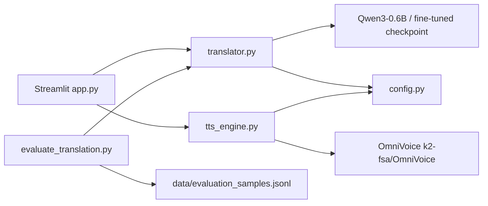

# Qwen Translator

**Translate Text. Generate Speech.**

A lightweight portfolio application that translates between Persian and English with [Qwen3-0.6B](https://huggingface.co/Qwen/Qwen3-0.6B) and generates speech from the translation with [OmniVoice](https://huggingface.co/k2-fsa/OmniVoice) (`k2-fsa/OmniVoice`).

Primary workflow:

**Enter text → Select languages → Translate → Display translation → Generate speech → Play or download WAV.**

> **Note:** Qwen3-0.6B is a general-purpose instruction model, not a dedicated MT system. This project evaluates base-model quality first; supervised fine-tuning is planned later and is **not** implemented in this version.

---

## Features

| Feature | Status |
| --- | --- |
| Persian ↔ English translation (manual language selection) | Implemented |
| Streamlit UI with RTL/LTR text direction | Implemented |
| Language swap (preserves input) | Implemented |
| OmniVoice TTS from **translated** text | Implemented |
| WAV playback + download | Implemented |
| Configurable model ID for future fine-tuned checkpoints | Implemented |
| Held-out evaluation script + SacreBLEU (optional) | Implemented |
| Unit tests (no weight download) | Implemented |
| Fine-tuning pipeline | Planned (not implemented) |

---

## Architecture



- **UI** never loads weights directly; it calls module APIs.
- **Translation** and **TTS** are independent — swapping the translation checkpoint does not require TTS changes.
- Models are loaded once and reused (`st.cache_resource` in the UI; module-level caches in the engines).

---

## Supported translation directions

1. Persian (`fa`) → English (`en`)
2. English (`en`) → Persian (`fa`)

Same-language pairs are rejected. Automatic language detection is **not** included.

---

## Model information

### Translation — Qwen/Qwen3-0.6B

| Item | Value |
| --- | --- |
| Type | Causal LM (instruction-tuned) |
| Parameters | 0.6B |
| Interface | Hugging Face Transformers `AutoModelForCausalLM` + chat template |
| Thinking mode | Disabled (`enable_thinking=False`) for clean translation output |
| Transformers | `>=4.51.0` (this project uses `>=5.3.0` for OmniVoice compatibility) |
| License | Apache 2.0 |
| Multilingual claim | Official card: 100+ languages / translation capability — **quality for Persian↔English must be measured**, not assumed |

### TTS — k2-fsa/OmniVoice

| Item | Value |
| --- | --- |
| Package | `omnivoice` ([PyPI](https://pypi.org/project/omnivoice/), [GitHub](https://github.com/k2-fsa/OmniVoice)) |
| Checkpoint | `k2-fsa/OmniVoice` |
| API | `OmniVoice.from_pretrained(...).generate(text=...)` |
| Audio | WAV, 24 kHz |
| Persian | Language ID `fa` listed in the [official language map](https://github.com/k2-fsa/OmniVoice/blob/master/docs/lang_id_name_map.tsv) (~366 hours training data) |
| Code license | Apache 2.0 |
| Model license | **CC-BY-NC** (non-commercial; constraints from training data such as Emilia) |

This app uses voice-design / auto-style generation (no reference audio upload) so the UI stays simple. Voice design is documented as primarily trained on Chinese and English; Persian may be less stable than English even though `fa` is listed.

---

## Installation

### Requirements

- **Python 3.11 or 3.12 recommended** (OmniVoice requires `>=3.10`)
- Windows 10/11 or Linux
- Optional NVIDIA GPU with recent drivers (CPU fallback supported, slower)
- Disk space for Hugging Face downloads (both models are ~0.6B-class)

### Windows / Linux

```bash
# Create and activate a virtual environment
python -m venv .venv

# Windows PowerShell
.\.venv\Scripts\Activate.ps1

# Linux / macOS
# source .venv/bin/activate

# Install PyTorch for your platform first (example: CUDA 12.8)
pip install torch torchaudio --index-url https://download.pytorch.org/whl/cu128

# Or CPU-only:
# pip install torch torchaudio --index-url https://download.pytorch.org/whl/cpu

# Install application dependencies
pip install -r requirements.txt

# Optional: copy environment overrides
copy .env.example .env   # Windows
# cp .env.example .env   # Linux
```

If Hugging Face downloads fail, you may set a mirror (as noted in OmniVoice docs):

```bash
# Linux / macOS
export HF_ENDPOINT=https://hf-mirror.com
```

---

## How to run

```bash
streamlit run app.py
```

### Kaggle notebook

For GPU evaluation on Kaggle (without the Streamlit UI), upload and run:

`notebooks/kaggle_qwen_translation_eval.ipynb`

Enable **GPU + Internet**, then run cells top-to-bottom. Results are saved under `/kaggle/working/outputs`.

Open the local URL shown in the terminal (typically `http://localhost:8501`).

### Using a fine-tuned checkpoint later

Train outside this repo, then point configuration at the saved directory:

```bash
# .env
TRANSLATION_MODEL_ID=./checkpoints/qwen3-fa-en-lora
```

No UI or TTS code changes are required if the checkpoint is Transformers-compatible with the Qwen3 chat template.

---

## Hardware requirements

| Component | Guidance |
| --- | --- |
| RAM | 8 GB+ recommended |
| GPU | Optional; 6–8 GB VRAM comfortable for both models (sequentially) |
| CPU mode | Works; translation and TTS will be slower |
| Disk | Several GB for caches under Hugging Face home |

---

## Evaluation

Held-out samples live in `data/evaluation_samples.jsonl` (not used for training).

```bash
# Both directions
python evaluate_translation.py

# One direction, first 4 examples
python evaluate_translation.py --direction fa-en --limit 4

# Against a local checkpoint
python evaluate_translation.py --model-id ./checkpoints/my-ft-model
```

Reports: example count, successes/failures, average latency, sample outputs, and SacreBLEU when `sacrebleu` is installed.

**Important:** Automatic metrics do not fully measure semantic accuracy or translation quality. Inspect outputs manually before deciding on fine-tuning targets.

---

## Testing

Unit tests do **not** download model weights:

```bash
pytest -q
```

Model integration tests are intentionally excluded from the default suite. End-to-end GPU/CPU inference must be verified manually with `streamlit run app.py` and/or `evaluate_translation.py`.

---

## Known limitations

1. **Base Qwen3-0.6B quality** for Persian↔English is not professional-grade (see evaluation notes below).
2. **Not a professional MT product** — instruction-based translation can still produce explanations, omissions, or awkward phrasing (the code applies light post-checks only).
3. **OmniVoice model license is CC-BY-NC** — commercial use of the pretrained weights is restricted.
4. **Voice design** is primarily Chinese/English-trained; Persian TTS may be less consistent than English even though `fa` is listed officially.
5. **VRAM** — loading both models at once on small GPUs may OOM; unload or use CPU if needed.
6. **Python 3.14** may lack wheels for some packages; prefer 3.11/3.12.
7. Fine-tuning, STT, RAG, and multi-language expansion are **not** implemented.

### Base-model evaluation notes (verified locally)

Smoke evaluation on held-out samples (`evaluate_translation.py --limit 4` each direction) with the **base** `Qwen/Qwen3-0.6B` checkpoint:

| Direction | Generations | Approx. SacreBLEU | Qualitative notes |
| --- | --- | ---: | --- |
| `fa→en` | 4/4 OK | ~19.6 | Simple questions can be fine; everyday sentences may drop meaning (e.g. weather → “Today is very good”); informal speech can fail badly |
| `en→fa` | 4/4 OK | ~1.3 | Outputs often fail to preserve meaning — **primary candidate for fine-tuning** |

**Weaknesses to target before building a large SFT dataset:**

1. English → Persian semantic fidelity (highest priority)
2. Informal / colloquial Persian → English
3. Completeness (omitted clauses, names, and time expressions)
4. Fluency of generated Persian (avoid fluent-looking but wrong text)

Do **not** treat SacreBLEU alone as a go/no-go signal — inspect outputs manually.

### TTS verification (verified locally)

OmniVoice (`k2-fsa/OmniVoice`) successfully wrote WAV files for both English and Persian sample texts on an NVIDIA GPU in this environment. Perceptual quality was not formally scored.

---

## Future fine-tuning plan

When base-model weaknesses are documented (see above):

1. Collect a high-quality Persian–English parallel dataset (domains matching intended use).
2. Train/validation/held-out test splits — **never** train on the test set.
3. Supervised fine-tuning of Qwen3-0.6B; consider LoRA/QLoRA **after** checking VRAM and dependency compatibility.
4. Evaluate before vs after with the same `evaluate_translation.py` samples plus human review.
5. Point `TRANSLATION_MODEL_ID` at the new checkpoint.

Do not assume a small dataset will automatically improve quality.

---

## Project layout

```
TTS-translate/
├── app.py
├── translator.py
├── tts_engine.py
├── config.py
├── evaluate_translation.py
├── requirements.txt
├── README.md
├── .gitignore
├── .env.example
├── assets/styles.css
├── outputs/
├── data/evaluation_samples.jsonl
└── tests/
    ├── test_translator.py
    ├── test_validation.py
    └── test_tts_validation.py
```

---

## Licensing summary

| Component | License |
| --- | --- |
| This application code | Use/adapt for portfolio work; respect dependency licenses |
| Qwen3-0.6B | Apache 2.0 |
| OmniVoice code | Apache 2.0 |
| OmniVoice pretrained weights | CC-BY-NC |

---

## Phase 1 verification summary (pre-implementation)

| Check | Finding |
| --- | --- |
| Qwen3 inference | Official Transformers chat template; `enable_thinking` switch documented |
| Non-thinking mode | Supported — used for translation |
| Qwen license | Apache 2.0 |
| OmniVoice repo | https://github.com/k2-fsa/OmniVoice |
| OmniVoice API | `OmniVoice.from_pretrained` + `generate` (verified from official README) |
| Persian TTS listed | Yes — `fa` / `fas` in official language TSV (~366h) |
| OmniVoice model license | CC-BY-NC |

Runtime verification of translation quality, Persian audio quality, GPU acceleration, and full test execution depends on the local environment after dependency installation.
